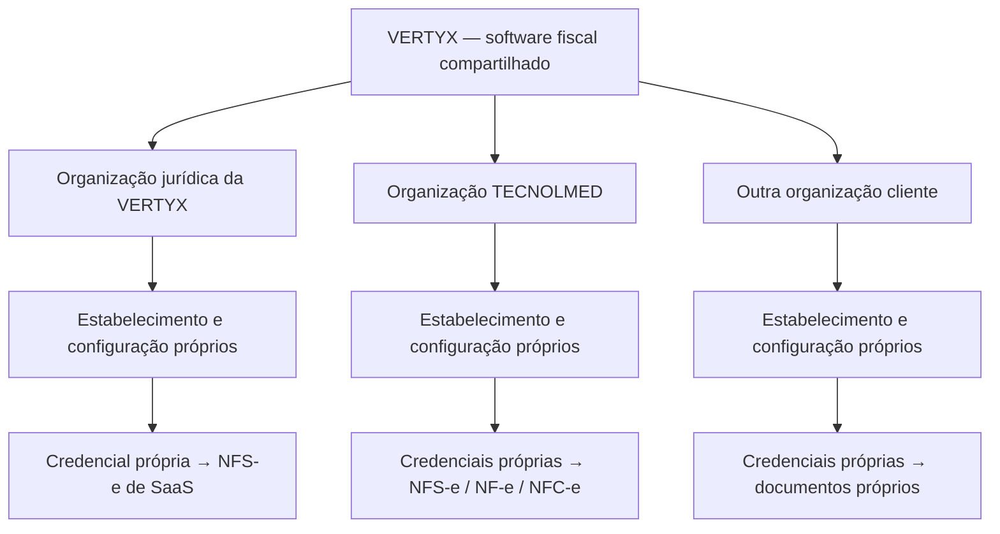

# VERTYX — arquitetura fiscal proposta para aprovação

Data: 07/10/2026. Estado: **PROPOSTA; IMPLEMENTAÇÃO NÃO INICIADA**.

Este documento consolida os dois textos enviados nesta etapa. Somente a arquitetura foi preparada. Não altera código, migrations, banco, credenciais, usuários, memberships, PDV, PWAs, RH ou produção. Não autoriza commit, push, deploy ou emissão real.

## 1. Princípio e separação entre emitentes

**A VERTYX emite suas próprias NFS-e pelo serviço SaaS. Cada empresa cliente emite seus documentos usando sua própria identidade fiscal.**

A empresa jurídica que comercializa a VERTYX será representada por uma Organization própria e estabelecimentos próprios. Sua configuração só será cadastrada quando sua identidade jurídica real for informada e validada; não criar organização, CNPJ, certificado ou credencial fictícios. A marca VERTYX não substitui razão social/CNPJ.

A TECNOLMED e os demais clientes continuam sendo organizações independentes. Nenhuma emissão de cliente pode usar configuração ou material criptográfico da organização emitente do SaaS. Ausência de credencial do cliente bloqueia emissão: nunca procurar um certificado global como alternativa.

Compartilhar implementação não compartilha identidade fiscal, certificados, senhas, CSC, documentos ou numeração. Administrador de tenant não recebe acesso à área de faturamento da plataforma nem às outras empresas.

## 2. O que já existe e será reaproveitado

| Estrutura atual | Reaproveitamento / evolução proposta |
|---|---|
| platform_core.Organization e OrganizationMembership | Identidade e seleção de organização autenticada; nenhuma estrutura paralela de empresas/usuários. |
| platform_core.FilialEmpresa | Estabelecimento da empresa operadora; já possui CNPJ, IE e IM. Não confundir com clientes.Unidade, que é unidade do tomador. |
| platform_core.tenancy, tenant_context, gestao.Validado | Consultas e validação de relações por tenant; sem contexto, negar acesso. |
| operacao.DocumentoFiscal | Registro principal já contém NFSE/NFE/NFCE, organização herdada, origens, série, número, protocolo, status e ambiente. Evoluir este model; não criar outro DocumentoFiscal. |
| operacao.Configuracao | Preservar campos fiscais legados; configuração detalhada futura por estabelecimento/tipo/ambiente. Valores antigos não passam a autorizar emissão. |
| fiscal.services e fiscal.providers | Evoluir a camada já existente para orquestração e motores especializados. Registro de adaptadores ADAPTERS atualmente vazio; sem emissão real configurada. |
| operacao.Documento e ordens.storage.PrivateStorage | XML/PDF privados, hash e download autenticado com no-store. Documentos de negócio não serão usados como cofre de certificados. |
| gestao.services.audit e PlatformAudit | Auditoria existente, complementada por eventos fiscais imutáveis. |
| operacao.Venda, pagamentos e snapshots | Origem comercial confirmada; não repetir estoque, financeiro ou pagamento por causa de um retry fiscal. |
| commercial.PlanoComercial / InteresseComercial | Catálogo/lead; não são assinatura, cobrança ou nota fiscal. Não emitir a partir de pedido de demonstração. |

Limitações observadas: ainda não há perfil fiscal por estabelecimento, credencial versionada, numeração fiscal transacional ou motores fiscais separados. O serviço atual usa payload comum e comunicação dentro de uma transação: isso precisa evoluir antes de registrar qualquer provedor real. Ter número/protocolo informado por um adaptador não basta para comprovar autorização; a resposta fiscal deve ser verificada pelo motor correspondente.

## 3. Modelos conceituais necessários

Os nomes novos abaixo são propostas, não classes implementadas. Models persistidos de negócio terão organization e validação de vínculo com o mesmo tenant. Relações históricas usam proteção contra exclusão e os documentos mantêm snapshots para não mudar quando um cadastro é editado.

| Model / estrutura | Campos e responsabilidade |
|---|---|
| FilialEmpresa + PerfilFiscalEstabelecimento | Reutilizar FilialEmpresa. Perfil fiscal 1:1 acrescenta endereço estruturado, município IBGE, UF, país, regime, atividades e vigência fiscal. Dados já existentes não serão duplicados em outro cadastro de filial. |
| ConfiguracaoFiscal | Organization, estabelecimento, tipo de documento, ambiente, integração, versão de leiaute, habilitação, parâmetros públicos e vigência. Configuração ativa inequívoca por estabelecimento/tipo/ambiente. |
| CredencialFiscal | Organization, titular, mecanismo A1/token/autenticação municipal, referência opaca ao cofre, fingerprint público, validade, versão, estado ativo/revogado/substituído e ambientes autorizados. Sem senha, CSC, token ou chave privada em coluna de texto. |
| VinculoCredencialFiscal | Autoriza expressamente quais estabelecimentos/configurações da mesma organização podem usar a credencial. Não há vínculo entre tenants; conferir compatibilidade do titular conforme integração. |
| SerieFiscal / ReservaNumeracaoFiscal | Organization, estabelecimento, tipo/modelo, ambiente, série, próximo número quando controlado pelo emitente; reserva vinculada a uma intenção/documento. Numeração remota da NFS-e não será inventada pelo ERP. |
| RegraTributariaFiscal | Organização/estabelecimento, motor, operação, vigência, classificações e parâmetros aprovados. Regras de NFS-e, NF-e e NFC-e separadas; versionadas. |
| DocumentoFiscal existente | Acrescentar estabelecimento, configuração e versão de credencial utilizadas, modelo, chave/identificador externo, datas de solicitação/emissão/autorização, idempotência, snapshot de emitente/destinatário/itens/impostos, hashes e referências ao XML/auxiliar existentes. |
| DetalhesNFSe | DocumentoFiscal 1:1; tomador, competência, município de incidência, serviço, retenções, DPS ou RPS quando o adaptador exigir, identificação municipal e substituição. |
| DetalhesNFe | DocumentoFiscal 1:1; modelo 55, operação/finalidade, destinatário, itens tributários, transporte/referências quando aplicáveis e resposta SEFAZ. |
| DetalhesNFCe | DocumentoFiscal 1:1; modelo 65, venda/caixa, destinatário conforme regra aplicável, pagamentos, QR/consulta, dados específicos de emissão normal ou contingência. |
| SolicitacaoFiscal / TentativaFiscal | Intenção persistida, operação emitir/consultar/cancelar etc., hash da requisição, estado do processamento, correlação externa, retry e resultado sanitizado. Estado de transporte separado do estado jurídico do documento. |
| EventoFiscal | Histórico imutável de emissões, consultas relevantes, rejeições, autorizações, cancelamentos e demais eventos suportados; usuário, organização, estabelecimento, ambiente, data/hora e protocolo/resposta comprovada. |

Tipos e modelos não serão tratados como sinônimos: NF-e usa 55 e NFC-e 65; NFS-e tem identificação de schema/provedor próprio e não receberá artificialmente um desses modelos. Detalhes específicos terão relação 1:1 com o documento central e exatamente um detalhe compatível com seu tipo.

O cliente fiscal atualmente obrigatório requer tratamento específico na futura evolução para NFC-e com consumidor não identificado, quando admitido. Não criar cliente fictício: usar destinatário em snapshot e relação opcional conforme o motor. Essa mudança será submetida em migration futura, preservando relações existentes.

## 4. Isolamento e autorização

Em requisição web, Organization provém de request.organization e membership ativa verificada pelo middleware. Não aceitar organization_id, CNPJ emitente ou referência de certificado do navegador como autoridade. IDs de estabelecimento/origem recebidos serão resolvidos apenas em querysets da organização autenticada.

Todo serviço fiscal validará: membership/capacidade, estabelecimento/configuração, origem comercial, documento, credencial e ambiente. Nenhum all_objects em views. Escritas passarão por serviços e validação tenant; nunca alterar saldos ou status por formulário genérico. Constraints de unicidade, transações e validação de relações complementarão a autorização. O manager filtrado não substitui autorização de credenciais nem validação de jobs.

Capacidades propostas: fiscal_consultar, fiscal_emitir, fiscal_cancelar, fiscal_configurar e fiscal_gerenciar_credenciais. Não mudar permissões atuais nesta etapa. Operar PDV não concede administração fiscal/consulta a certificado. VENDEDOR e TÉCNICO não recebem acesso administrativo fiscal. A futura emissão automática de uma venda será uma política aprovada daquele estabelecimento, executada pelo serviço, sem expor a credencial ao operador.

Jobs persistidos carregam organization, estabelecimento, documento, configuração e identidade da solicitação, definidos pelo backend. Antes de execução, o worker revalida titularidade, ambiente e autorização aplicável. Webhooks exigem assinatura/autenticação, proteção contra replay e correlação com solicitação já registrada; nenhum organization_id do callback seleciona livremente o tenant.

XML/PDF exigem autorização antes do stream/download; caminhos por UUID de organização e acesso no-store. Nunca armazenar arquivos ou credenciais fiscais no cache de service worker. O prefixo do arquivo organiza os objetos, mas a permissão real é aplicada no backend/cofre.

## 5. Certificados e credenciais

Proposta preferencial: cofre gerenciado com controle de acesso e criptografia, segregado por organização, versão e ambiente. A aplicação guarda somente referência opaca e metadados públicos. Pode ser adotada custódia pelo integrador fiscal caso seja aprovada, com identidade por emitente e procedimento seguro de cadastro/rotação. Nenhum serviço será contratado/configurado agora.

R2 privado existente é adequado para documentos; sua privacidade não o transforma automaticamente em cofre de A1. Caso se aprove guardar blobs de certificado em object storage, eles deverão ser cifrados na aplicação com chave de dados por credencial, protegida por KMS/cofre separado. Senha e chave de decifragem não ficam junto do objeto. Essa infraestrutura depende de decisão posterior; não alterar o R2 atual.

Nenhuma derivação de chave usando SECRET_KEY do Django, nenhuma credencial global de tenant e nenhum fallback para o certificado da VERTYX. A identidade técnica do worker para acessar o cofre não é certificado de emitente e não substitui validação da organização.

Upload autorizado, quando necessário: canal TLS para backend/cofre, limite/tipo do arquivo, validação de titular, validade e capacidade de assinatura, sem devolver o arquivo/chave/senha ao navegador. Não disponibilizar A1 em operacao.Documento, URLs assinadas públicas, JavaScript, IndexedDB, logs, repositório ou backups em texto claro. Dados descriptografados apenas durante a operação no processo autorizado; evitar arquivos temporários e excluir material temporário quando inevitável.

Rotação cria versão nova; revogação impede novos usos; histórico referencia a versão usada sem expor o segredo. A tela mostra titular/fingerprint/validade/estado, nunca senha, token ou CSC. Auditoria registra acesso/rotação/uso por referência, não material sensível. Futura integração deve redigir erros do provedor e validar TLS/destinos; sem requests para endpoints livres enviados pelo cliente.

## 6. NFS-e da VERTYX e faturamento SaaS

Fluxo futuro: contrato/assinatura de SaaS efetivamente existente → cobrança/competência → serviço prestado → DocumentoFiscal de NFS-e pertencente à organização jurídica da VERTYX. O tomador é cadastrado/snapshot no contexto da organização emitente, sem reutilizar indevidamente Cliente de outro tenant.

O cadastro comercial atual tem catálogo e pedidos de demonstração; não há assinatura/cobrança SaaS automática implementada. A arquitetura admite vínculo futuro de origem CobrancaSaaS, mas não implementa gateway nem faturamento automático aqui. Emissão deve seguir a competência/fato gerador aprovado pelo contador, sem presumir que pagamento recebido é sempre o gatilho.

Administrador do tenant cliente não administra documentos da organização VERTYX. Eventual disponibilização da NFS-e de SaaS ao seu tomador será uma entrega/portal específico com autorização do destinatário; não abrir a listagem fiscal inteira da organização emitente.

## 7. Motor NFS-e dos clientes

Cada estabelecimento configura município, provedor/rota, códigos de serviço e autenticação próprios. O motor NFSe terá adaptadores separados para Emissor Nacional quando aplicável e para cada integração municipal/versionada homologada. A documentação oficial distingue emissores e compartilhamento com ADN; adesão ao ADN não comprova que o município utiliza o mesmo endpoint de emissão. [FAQ oficial NFS-e](https://www.gov.br/nfse/pt-br/copy_of_perguntas-frequentes/copy_of_faq-nfs-e).

Emissor Nacional: modelar DPS, retorno NFS-e, consulta e eventos conforme schema/documentação vigente. Municipal: RPS/lote, autenticação, consulta/cancelamento/substituição somente quando suportados naquele município/provedor. Não prometer suporte a qualquer prefeitura nem usar payload único para todas. [Documentação técnica oficial atual](https://www.gov.br/nfse/pt-br/biblioteca/documentacao-tecnica/documentacao-atual).

Uma matriz de cobertura identificará município IBGE, integração/versionamento, autenticação, ambiente, documentos/eventos disponíveis e resultado da homologação. Só configurações aprovadas nessa matriz poderão emitir.

## 8. Motor NF-e

Motor dedicado ao modelo 55, com XML/schema vigente, assinatura, validação das classificações e valores, autorização/consulta SEFAZ e DANFE. Credenciamento, UF autorizadora, certificado e serviços devem ser verificados por estabelecimento. Transporte, destinatário, referências, cancelamento e outros eventos são específicos do documento/operação. Não reutilizar regras municipais de NFS-e. [Portal oficial — manuais NF-e/NFC-e](https://www.nfe.fazenda.gov.br/PORTAl/listaConteudo.aspx?AspxAutoDetectCookieSupport=1&tipoConteudo=ndIjl+iEFdE%3D).

Compartilhar primitivas de XML/assinatura/transporte com NFC-e não autoriza compartilhar automaticamente CFOP, finalidade, destinatário ou regras de eventos. Regra tributária não será inferida pelo ERP a partir de descrição do produto. Contador aprova parâmetros e vigência.

## 9. Motor NFC-e

Motor dedicado ao modelo 65, integrado à venda confirmada do estabelecimento cliente. Tratar pagamentos, consumidor, totais, troco, chave, QR/consulta, DANFE NFC-e e regras próprias. CSC/identificador, quando exigidos pela UF/versão adotada, são credenciais da organização e ambiente, nunca do SaaS nem visíveis no JavaScript. A versão do QR e suas exigências serão homologadas antes da ativação. [Portal oficial — especificações DANFE NFC-e/QR Code](https://www.nfe.fazenda.gov.br/portal/consultaRecaptcha.aspx/listaHistorico.aspx?AspxAutoDetectCookieSupport=1&tipoConteudo=Ef+Y1blZDbU%3D).

Comprovante de venda existente permanece não fiscal. Somente resposta oficial comprovada muda o documento para AUTORIZADA. Pagamento/venda confirmados não garantem autorização SEFAZ.

## 10. Integração, idempotência e numeração

Manter fiscal como a camada própria; separar implementações propostas em fiscal/motors/nfse, fiscal/motors/nfe e fiscal/motors/nfce. Evoluir fiscal/providers como contrato de transporte/provedor revisado. Registro explícito por tipo, município/UF, ambiente e versão, sem importar classe escolhida livremente por texto do usuário.

Estratégia: Emissor Nacional direto quando cobertura/cadastro permitirem; integração municipal por adaptador homologado; NF-e/NFC-e por integrador revisado ou conexão SEFAZ direta, conforme custo/cobertura/suporte escolhidos posteriormente. Não selecionar fornecedor nem contratar antes de conhecer municípios, UFs e volumes. Um eventual token técnico de plataforma não transforma a VERTYX em emitente e nunca pode selecionar empresa sem vínculo verificado.

Fluxo transacional proposto:

1. Backend valida tenant/origem/valores/configuração, congela snapshot e grava solicitação idempotente.
2. Reserva de número por transação e lock apenas quando o tipo/adaptador exigir numeração do emitente. Chave de unicidade inclui organização, estabelecimento, tipo/modelo, ambiente, série e número, sem colisão entre contextos.
3. Worker obtém credencial autorizada, assina/transmite fora da transação longa do banco.
4. Resposta é autenticada/validada, incluindo emitente, documento, ambiente, chave/protocolo e consistência dos valores conforme motor; então persiste resultado/documentos/evento em transação curta.
5. Timeout deixa estado de transporte RESULTADO_DESCONHECIDO ou EM_CONSULTA. Consultar/reconciliar antes de nova emissão; nunca novo número/documento por retry cego.

Solicitação de emissão é única por documento/revisão; origem comercial permite documentos diferentes somente por política explícita (por exemplo produtos/serviços separados), e não por repetição de botão. Repetição não duplica nota, estoque, recebível ou pagamento. Número reservado nunca é reutilizado automaticamente; lacunas/eventual inutilização seguem o motor. NFS-e autorizada com numeração do município registra retorno, sem fabricar sequência local.

## 11. Ambientes

Separar testes simulados sem autoridade fiscal, homologação oficial e produção. O valor legado SANDBOX não é prova de acesso à homologação oficial e não será reclassificado automaticamente. Configuração/versionamento futuro fará o mapeamento explícito preservando registros antigos.

Credenciais autorizadas por ambiente, séries/contadores segregados e armazenamento/documentos identificados por ambiente. Produção requer ativação explícita por organização/estabelecimento/tipo, além da capacidade do usuário e aprovação posterior; nenhum simples botão do navegador troca o destino. Homologação jamais deve atingir produção como fallback. [APIs oficiais NFS-e — produção restrita e produção](https://www.gov.br/nfse/pt-br/biblioteca/documentacao-tecnica/apis-prod-restrita-e-producao/apis-prod-restrita-e-producao).

Endpoints serão obtidos da documentação do adaptador escolhido e revisados, nunca inventados. Ambiente local atual permanece intacto. Não configurar Render/R2/cofre nem importar certificado nesta etapa.

## 12. Informações necessárias por organização / estabelecimento

Esta é uma matriz de onboarding a validar pelo motor/contador; não uma afirmação de que todos os campos são obrigatórios em todas as operações.

| Grupo | Dados necessários para habilitar a modalidade aplicável |
|---|---|
| Identidade | CNPJ real do emitente/estabelecimento, razão social, vinculação jurídica à organização e nome fantasia quando utilizado. |
| Localização | Endereço estruturado, número/complemento, bairro, CEP, município IBGE, UF, país e contato conforme schema. |
| Inscrições / regime | IE e IM, inclusive situações de isenção/não contribuinte quando admitidas; regime tributário/CRT, atividades e vigência aprovados. |
| Serviços / NFS-e | Município/provedor efetivo, cadastro/habilitação de emissão, código nacional/municipal de serviço e outras classificações aplicáveis, competência, tomador/local, incidência, retenções e regras aprovadas. |
| Mercadorias / NF-e e NFC-e | Credenciamento da UF/tipo, série/numeração, NCM, CFOP, CST/CSOSN e demais classificações/exigências aplicáveis por produto/operação, unidades, valores, totais e dados de destinatário/transporte quando exigidos. |
| Autenticação | Certificado ou mecanismo aceito pelo adaptador, titular e validade, credenciais por ambiente; CSC/identificador quando exigidos na configuração de NFC-e adotada. Informados somente por canal seguro. |
| Regras / vigência | Impostos, retenções, classificações e campos de evolução tributária aplicáveis ao leiaute/data; nenhuma alíquota, CNAE, código SaaS ou regra presumidos. |
| Operação | Estabelecimento/depósito/caixa da origem, políticas de emissão/eventos, pessoas autorizadas e contatos para rejeições/renovação. |

Suporte ao CNPJ alfanumérico e à evolução de schemas/regras tributárias deve integrar a avaliação de compatibilidade antes da implementação. O código atual possui validação/campos de CNPJ; não alterá-los nesta proposta. Versões e cronogramas devem ser conferidos na homologação do adaptador. [Evoluções oficiais NFS-e em produção restrita](https://www.gov.br/nfse/pt-br/noticias/plataforma-nfs-e-disponibiliza-novas-evolucoes-em-producao-restrita-e-divulga-cronograma-de-implantacao).

Nenhum dado fiscal real foi solicitado no chat nesta etapa. Para escolher o primeiro adaptador, faltam: pessoa jurídica emitente da VERTYX, municípios/UFs dos primeiros estabelecimentos, regime/atividades aprovados e tipos de nota prioritários. Depois da aprovação arquitetural, esses dados públicos poderão ser levantados; segredos terão canal separado.

## 13. PDV, vendas e documentos

Preservar o fluxo homologado: venda offline → fila local → servidor revalida → venda comercial confirmada. Somente então, quando a política fiscal aprovada estiver habilitada, criar solicitação fiscal referente àquela origem e estabelecimento. Sincronização da venda e autorização fiscal são estados separados.

Venda pode estar confirmada e nota pendente/rejeitada; apresentar isso claramente. Retry fiscal não desfaz venda silenciosamente, reabre caixa, repete estoque, cria recebível ou reprocessa pagamento. Cancelamento da venda e cancelamento da nota são operações distintas, com autorização e reconciliação específicas. Devolução também depende da regra documental aplicável.

Venda de produtos pode originar NF-e/NFC-e conforme operação; OS/serviço pode originar NFS-e. Operações mistas exigem classificação aprovada e conciliação dos valores entre documentos; não transformar tudo em NFC-e ou emitir dois documentos para os mesmos valores sem política. PWA Vendedor permanece pessoal, PWA Técnico permanece operacional, sem administração fiscal adicionada.

## 14. Contingência fiscal

O offline atual é comercial. Não existe emissão fiscal offline homologada. Solicitação pendente, XML gerado ou arquivo armazenado não significam autorização SEFAZ.

Futura contingência NFC-e exigirá validação de admissibilidade por UF, modo de emissão, numeração/chave, justificativa e horários, assinatura, representação auxiliar exigida, armazenamento durável, prazo e transmissão/reconciliação posterior. Sua máquina de estados distinguirá EM_CONTINGENCIA/AGUARDANDO_TRANSMISSAO de AUTORIZADA/REJEITADA, conforme o motor. A retransmissão mantém identidade do documento e não cria outra venda.

Há uma dependência arquitetural explícita: PWA desconectado não alcança o assinador em nuvem; A1/senha/CSC não devem ser colocados no JavaScript, cache ou IndexedDB para contornar isso. Uma contingência realmente fiscal no computador precisará de assinador local confiável, serviço/dispositivo com armazenamento de chave protegido ou outra solução admitida e homologada para a UF, mantendo chave privada fora do navegador. Não existe esse componente no projeto atual. Sua implementação requer escopo e aprovação próprios.

Até essa etapa: tela/comprovante offline informa pendência comercial/não fiscal; retorno da internet segue o fluxo fiscal normal autorizado, sem simular retroativamente uma contingência. Falhas de NFC-e terão revisão operacional, sem declaração automática de conformidade legal. Contingências de NF-e/NFS-e são separadas e só entram onde documentação/integração permitem.

## 15. Auditoria, evolução e critérios de aprovação

Eventos incluirão organização/estabelecimento, usuário ou identidade técnica, membership solicitante, documento, origem comercial, ambiente, operação, data/hora, status anterior/posterior, motivo, idempotência, protocolo e hashes de conteúdo. Manter XML original/autorizado e eventos como artefatos versionados/imutáveis. Troca de cadastro ou certificado não reescreve emissão anterior.

Logs operacionais são sanitizados; XML fiscal com dados pessoais fica em armazenamento privado, não no log. Certificado, senha, CSC, token e chave privada nunca entram em diff de auditoria. Política de retenção dos documentos/backups será definida conforme obrigações aplicáveis e contrato, sem inventar prazo universal.

Implementação futura preservará DocumentoFiscal e tabelas atuais. Primeiro acrescentar relações/campos opcionais/novas tabelas; registros legados permanecem sem estabelecimento validado e com emissão bloqueada até saneamento explícito. Sem atribuir filial/CNPJ/certificado/numeração automaticamente por suposição, apagar documentos ou alterar migrations antigas. Changes necessários para consumidor não identificado e CNPJ compatível serão planejados e testados separadamente.

Testes futuros obrigatórios: isolamento de documentos/arquivos/credenciais/séries, relação com origem de outro tenant, spoof de organization_id/estabelecimento/certificado, VERTYX versus clientes, permissão fiscal distinta de operar_pdv, ambiente sem fallback, numeração concorrente, retry após timeout, webhook repetido/inválido, renovação/revogação, XML/status/autorização comprovada, regra por motor, migração com dados antigos e suíte completa dos módulos preservados. Homologação oficial por adaptador/município/UF e ativação em produção serão etapas distintas.

**Decisões submetidas agora:** reaproveitar a base existente; organização própria da empresa VERTYX; FilialEmpresa como estabelecimento; credenciais segregadas em cofre; três motores com contratos especializados; processamento idempotente e estados separados; contingência NFC-e como componente futuro específico. Município/provedor, custódia concreta, cobrança SaaS e contingência local serão detalhados após aprovação e levantamento dos dados necessários.

**Resultado desta etapa:** apenas este documento foi criado. Nenhuma emissão, integração real, certificado, CSC, migration, mudança de funcionalidade ou acesso a produção realizado. Aguardar aprovação antes de implementar.
